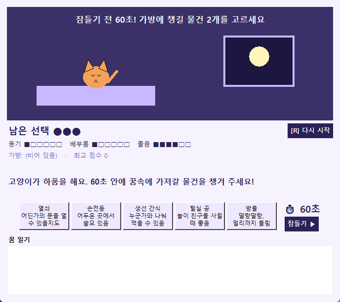
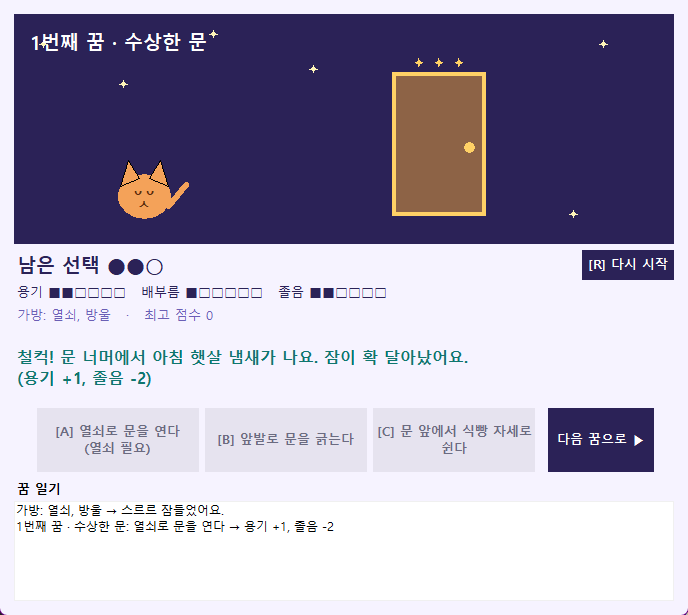
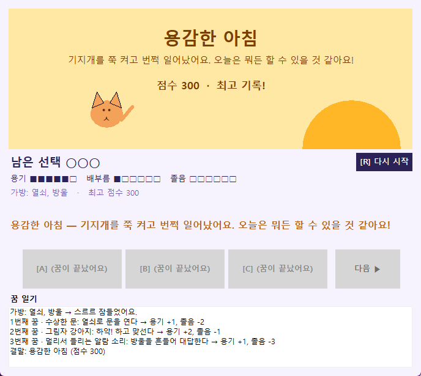

# 🐱 고양이의 꿈 일기

꿈속에 갇힌 고양이가 **딱 세 번의 선택**으로 아침을 맞아야 하는 선택지 이야기 게임입니다.
'60 Seconds!'처럼 잠들기 전 60초 동안 물건을 챙기고, 꿈 장면마다 선택지를 골라 다음 장면으로 넘어갑니다.

> K-Digital 피지컬AI 과정 · 파이썬 미니 프로젝트 (2026-10-15)

## 🎮 [브라우저에서 바로 플레이하기](https://dididip.github.io/cat-dream-story/)

설치 없이 PC·휴대폰 브라우저에서 플레이할 수 있습니다. 움직이는 그림, 효과음, 결말 모으기가 들어간 웹 버전입니다.

- Python 코드가 브라우저에서 그대로 돌아가는 버전: [Python(PyScript) 버전](https://dididip.github.io/cat-dream-story/python/) (처음 열 때 몇 초 걸림)

| 잠들기 전 60초 | 꿈 장면 | 결말 |
|---|---|---|
|  |  |  |

## 미션 조합

| 요소 | 뽑은 단어 | 프로그램에 반영한 곳 |
|---|---|---|
| 장르 | 미니 게임 | 준비 단계 + 장면별 선택지 + 결말과 점수가 있는 게임 |
| 주어 | 고양이 | 주인공. 꿈에서 깨어나 아침을 맞아야 함 |
| 공간 | 꿈속 | 수상한 문, 생선 강, 깜깜한 동굴, 털실 공, 그림자 강아지, 구름 침대, 알람 소리 |
| 돌발 상황 | 버튼을 딱 세 번만 누를 수 있다 | 꿈속 선택은 세 번뿐. 다 쓰면 선택 버튼이 잠기고, 네 번째 클릭은 깜빡이며 막힘. 다시 시작은 언제나 가능 |

## 파일 구성

| 파일 | 설명 |
|---|---|
| `cat_dream_story.py` | 데스크톱 버전 (tkinter 창) |
| `docs/index.html` | 웹 버전 (GitHub Pages 첫 화면). 같은 규칙에 캔버스 애니메이션·효과음·결말 모으기 추가 |
| `docs/python/` | Python(PyScript) 웹 버전. 규칙은 데스크톱과 같고 화면만 HTML·SVG로 그림 |

## 데스크톱 버전 실행 방법

Python 3만 있으면 됩니다. 화면은 Python 기본 도구인 tkinter로 만들어서 따로 설치할 것이 없습니다.

```
python -X utf8 cat_dream_story.py
```

`python` 명령을 찾지 못하면 `py -X utf8 cat_dream_story.py`로 실행하세요.

## 게임 방법

1. **잠들기 전 60초**: 열쇠·손전등·생선 간식·털실 공·방울 중 2개를 챙깁니다. 시간이 끝나면 아무거나 챙겨집니다.
2. **꿈 장면 3개**: A·B·C 중 하나를 고르면 결과가 나오고 **다음 ▶**으로 넘어갑니다.
   어떤 선택지는 챙긴 물건이 있어야 고를 수 있습니다.
3. **결말**: 용기·배부름·졸음 수치로 결말이 정해집니다.
   용감한 아침 / 상쾌한 아침 / 비몽사몽 아침 / 끝나지 않는 꿈 / 끝나지 않는 악몽

| 조작 | 키 |
|---|---|
| 선택 | A · B · C (또는 1 · 2 · 3) |
| 잠들기 / 다음 | 스페이스 또는 엔터 |
| 다시 시작 | R |

최고 점수는 `work/cat_story_best.json`에 저장되어 프로그램을 껐다 켜도 남습니다.

## 핵심 기능

1. 60초 타이머와 함께 물건 2개 챙기기 (가방이 차면 안내)
2. 장면마다 선택 → 결과 → 다음 장면으로 넘어가기 (물건에 따라 열리는 선택지)
3. 수치에 따른 결말 판정과 최고 점수 저장

## 시험 기록

- 물건 조합 10 × 장면 순서 30 × 선택 27가지를 모두 돌려 본 결과, **성공 결말이 불가능한 판은 0개**
- 물건 3개째 넣기 → "가방이 꽉 찼어요" 안내
- 결과를 읽는 중 다른 선택 클릭 → 무시되고 선택 횟수 유지
- 60초가 끝나면 자동으로 물건을 챙기고 잠듦
- 선택 세 번 후 네 번째 클릭 → 막히고 "막힌 클릭" 기록, 다시 시작하면 정상 동작
- 최고 점수 파일이 없거나 망가져도 0점으로 시작
